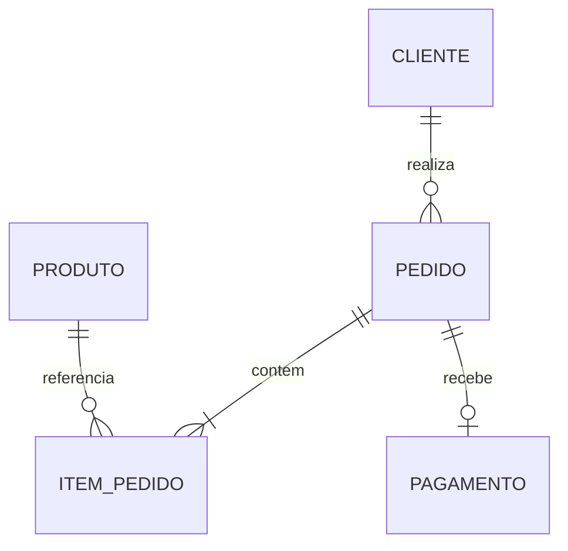

# Order Management API

REST API de gerenciamento de clientes, produtos e pedidos construída com ASP.NET Core, Entity Framework Core e SQL Server.

Esta é a versão integradora da **Semana 7**. Ela evolui o CRUD persistente de produtos da Semana 6 para um fluxo completo de pedidos, sem adicionar estoque ou autenticação antes da hora.

## O que a API faz

- CRUD assíncrono de clientes e produtos;
- criação de pedido com vários itens;
- snapshot do preço do produto no momento da compra;
- pagamento por Pix (0%) ou cartão (3%);
- fluxo de status controlado;
- consulta de pedidos com cliente, itens, produtos e pagamento;
- filtros opcionais por cliente e status;
- validações de entrada e regras de negócio;
- persistência em SQL Server com EF Core e migrations.

## Domínio



Estados possíveis do pedido:

```text
Criado -> AguardandoPagamento -> Pago -> Enviado -> Entregue
                 |                 |
                 +----> Cancelado <-+
```

`Entregue` e `Cancelado` são estados finais.

## Tecnologias

- .NET 10 / ASP.NET Core
- Entity Framework Core 10
- SQL Server LocalDB
- Controllers, DTOs, Services e Repositories
- OpenAPI

## Endpoints principais

| Método | Rota | Finalidade |
|---|---|---|
| `GET` | `/api/status` | Verificar a API |
| `GET/POST` | `/api/clientes` | Listar e cadastrar clientes |
| `GET/PUT/DELETE` | `/api/clientes/{id}` | Consultar, atualizar e excluir cliente |
| `GET/POST` | `/api/produtos` | Listar e cadastrar produtos |
| `GET/PUT/DELETE` | `/api/produtos/{id}` | Consultar, atualizar e excluir produto |
| `GET` | `/api/pedidos` | Listar pedidos e aplicar filtros |
| `GET` | `/api/pedidos/{id}` | Consultar o pedido completo |
| `POST` | `/api/pedidos` | Criar pedido |
| `POST` | `/api/pedidos/{id}/pagamento` | Pagar pedido |
| `PATCH` | `/api/pedidos/{id}/status` | Enviar, entregar ou cancelar pedido |

## Preparação local obrigatória

O projeto já inclui as migrations necessárias para o fluxo de pedidos. Para preparar o ambiente local, restaure as dependências, compile e aplique as migrations existentes ao banco usando os comandos abaixo.

```bash
dotnet tool restore
dotnet restore
dotnet build
dotnet ef database update
dotnet run --launch-profile http
```

O projeto possui um manifesto local que restaura a versão `10.0.10` do `dotnet-ef`, igual à versão dos pacotes do EF Core.

Quando as migrations forem alteradas, gere novamente o script SQL versionado:

```bash
dotnet ef migrations script --idempotent --output DatabaseScripts/OrderManagementApiDb.sql
```

Use [OrderManagementApi.http](OrderManagementApi.http) para executar o fluxo completo.

## Documentação de estudo

- [Arquitetura e regras](docs/ARQUITETURA.md)
- [Mapa de mudanças da Semana 6 para a 7](docs/MAPA_DE_MUDANCAS.md)
- [Configuração e teste local](docs/SETUP_LOCAL.md)
- [Guia acelerado da Semana 7](docs/GUIA_ESTUDO_SEMANA_7.md)
- [Relatório de validação da entrega](docs/RELATORIO_DE_VALIDACAO.md)

## Escopo consciente

Estoque, autenticação, testes automatizados, deploy e observabilidade ficam fora desta entrega. O objetivo aqui é consolidar relacionamentos, consultas com dados relacionados, DTOs, regras de negócio e consistência do banco antes da preparação profissional da Semana 8.
