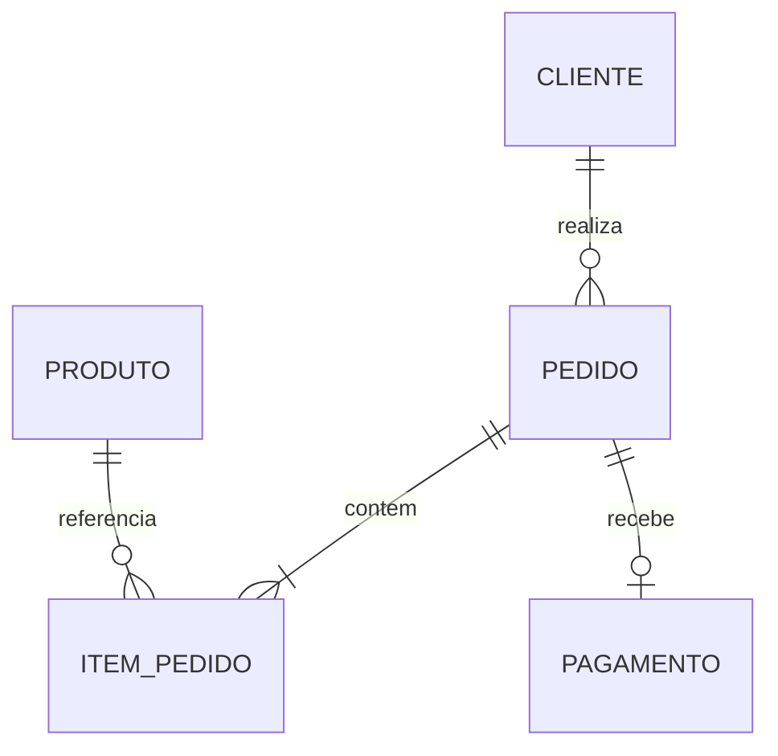

# Order Management API

REST API de gerenciamento de clientes, produtos e pedidos construída com ASP.NET Core, Entity Framework Core e SQL Server.

O fluxo de pedidos foi consolidado na **Semana 7**. Na **Semana 8**, o projeto recebe testes automatizados e melhorias de execução e documentação para apresentação como portfólio de backend.

## O que a API faz

- CRUD assíncrono de clientes e produtos;
- criação de pedido com vários itens;
- snapshot do preço do produto no momento da compra;
- pagamento por Pix (0%) ou cartão (3%);
- fluxo de status controlado;
- consulta de pedidos com cliente, itens, produtos e pagamento;
- filtros opcionais por cliente e status;
- validações de entrada e regras de negócio;
- persistência em SQL Server com EF Core e migrations.

## Domínio



Estados possíveis do pedido:

```text
Criado -> AguardandoPagamento -> Pago -> Enviado -> Entregue
                 |                 |
                 +----> Cancelado <-+
```

`Entregue` e `Cancelado` são estados finais.

## Tecnologias

- .NET 10 / ASP.NET Core
- Entity Framework Core 10
- SQL Server LocalDB
- Controllers, DTOs, Services e Repositories
- OpenAPI
- xUnit e NSubstitute para testes unitários
- WebApplicationFactory / TestServer e SQL Server para testes de integração

## Endpoints principais

| Método | Rota | Finalidade |
|---|---|---|
| `GET` | `/api/status` | Verificar a API |
| `GET/POST` | `/api/clientes` | Listar e cadastrar clientes |
| `GET/PUT/DELETE` | `/api/clientes/{id}` | Consultar, atualizar e excluir cliente |
| `GET/POST` | `/api/produtos` | Listar e cadastrar produtos |
| `GET/PUT/DELETE` | `/api/produtos/{id}` | Consultar, atualizar e excluir produto |
| `GET` | `/api/pedidos` | Listar pedidos e aplicar filtros |
| `GET` | `/api/pedidos/{id}` | Consultar o pedido completo |
| `POST` | `/api/pedidos` | Criar pedido |
| `POST` | `/api/pedidos/{id}/pagamento` | Pagar pedido |
| `PATCH` | `/api/pedidos/{id}/status` | Enviar, entregar ou cancelar pedido |

## Execução com Docker

O repositório inclui Dockerfile, Compose e um script PowerShell para iniciar a API .NET 10 com SQL Server 2022 Developer em containers Linux. O banco do Docker é separado do LocalDB e usa volume persistente.

Após instalar Docker Desktop com WSL 2, execute na raiz:

```powershell
.\scripts\Start-Docker.ps1
```

O script cria uma senha aleatória no arquivo .env local, valida o Compose, inicia os serviços e consulta a API e os produtos. A API usa http://localhost:5211 por padrão.

**Validação local em 30/10/2026:** imagem construída, SQL Server saudável, API online e quatro produtos iniciais consultados. Um cliente cadastrado via HTTP permaneceu disponível com os mesmos dados depois de parar e iniciar os containers, mantendo o volume. Os testes de integração existentes continuam usando LocalDB no Windows.

Veja [requisitos, configuração e comandos do Docker](docs/DOCKER.md).

## Preparação local obrigatória

O projeto já inclui as migrations necessárias para o fluxo de pedidos. Para preparar o ambiente local, restaure as dependências, compile e aplique as migrations existentes ao banco usando os comandos abaixo.

```bash
dotnet tool restore
dotnet restore
dotnet build
dotnet ef database update
dotnet run --launch-profile http
```

O projeto possui um manifesto local que restaura a versão `10.0.10` do `dotnet-ef`, igual à versão dos pacotes do EF Core.

Quando as migrations forem alteradas, gere novamente o script SQL versionado:

```bash
dotnet ef migrations script --idempotent --output DatabaseScripts/OrderManagementApiDb.sql
```

Use [OrderManagementApi.http](OrderManagementApi.http) para executar o fluxo completo.

## Testes automatizados

Os projetos de testes usam o SDK .NET 10. Execute os comandos abaixo na raiz do repositório; cada comando restaura as dependências necessárias e compila os projetos.

### Testes unitários — 10 cenários

```bash
dotnet test tests/OrderManagementApi.Tests/OrderManagementApi.Tests.csproj
```

Usam o `PedidoService` real e repositórios simulados com NSubstitute. Não precisam iniciar a API ou configurar um banco.

| Regra verificada | Casos |
|---|---:|
| Cartão: base de R$360, taxa de R$10,80 e total de R$370,80 | 1 |
| Pix: base de R$360, taxa zero e total de R$360 | 1 |
| Segundo pagamento recusado, preservando o primeiro | 1 |
| Transições proibidas: Pago → Entregue, Cancelado → Enviado, Entregue → Cancelado | 3 |
| Transições permitidas: Pago → Enviado, Enviado → Entregue, Pago → Cancelado | 3 |
| Pagamento usa o preço histórico do item após alteração do preço do produto | 1 |
| **Total unitário** | **10** |

A preparação comum fica em métodos auxiliares; cada cenário cria seus próprios objetos e substitutos.

### Testes de integração — 10 cenários

Pré-requisitos desta versão: **Windows, SDK .NET 10 e SQL Server LocalDB com a instância `MSSQLLocalDB` disponível para o usuário que executa os testes**.

```bash
dotnet test tests/OrderManagementApi.IntegrationTests/OrderManagementApi.IntegrationTests.csproj
```

O `WebApplicationFactory` inicia a API automaticamente com `TestServer`, em ambiente `Testing`. As requisições HTTP passam pelas rotas e controllers reais, sem precisar executar `dotnet run` nem ocupar a porta 5211.

Nos cenários com banco, a `ApiWebApplicationFactory` cria uma conexão exclusiva para `OrderManagementApiTests_<GUID>`, confere o nome do banco configurado e aplica as migrations versionadas. Os testes usam serviços, repositórios e EF Core reais. Ao encerrar cada instância com `using`, a factory remove apenas o banco temporário gerado por ela. Não é necessário executar `dotnet ef database update` para preparar esses bancos.

A configuração de teste substitui as opções do DbContext e não usa o seed do banco de estudo. Os registros necessários são cadastrados pelo próprio teste, via HTTP. O teste de `/api/status` é independente do banco.

| Cenário verificado por HTTP | Casos |
|---|---:|
| Status: 200, JSON, identificação da API e data UTC | 1 |
| Cadastro de cliente: 201, Location e consulta independente com 200 | 1 |
| E-mail repetido: 409 e cadastro original preservado | 1 |
| Criação de pedido e preço histórico: produto de 100 para 199,90, item permanece 100 e total 200 | 1 |
| Pedido com cliente inativo ou produto inativo: 409 e nenhum pedido gravado | 2 |
| Produto repetido no pedido: 400 e nenhum pedido gravado | 1 |
| Pedido inexistente: 404 com ProblemDetails | 1 |
| Fluxo Pix e cartão: pagamento, recusas de duplicidade/entrega fora de ordem, envio e entrega | 2 |
| **Total de integração** | **10** |

No fluxo de pagamento, a base é R$200: Pix mantém taxa zero e total R$200; cartão aplica taxa de R$6 e total R$206. Novas consultas conferem a persistência dos estados e dos valores, inclusive após as recusas.

### Resultado local e limites

Execuções locais confirmadas em **29/10/2026**: **10 unitários e 10 de integração aprovados**, com **0 falhas e 0 ignorados** em cada projeto. A última verificação unitária ocorreu depois das alterações necessárias aos testes HTTP.

Os unitários não exercitam persistência. Os testes de integração incluem a cópia automática do preço na criação e sua preservação no SQL Server; os cenários de erro conferem o código HTTP e o conteúdo de ProblemDetails. Esse conjunto cobre os cenários enumerados, sem medir carga ou concorrência entre pagamentos simultâneos. Os pagamentos continuam simulados.

O roteiro manual está em [OrderManagementApi.http](OrderManagementApi.http). As instruções de integração acima usam LocalDB no Windows. O ambiente Docker executa a aplicação em Linux; o workflow de CI usa Windows para executar as suítes atuais.

A referência explícita a `System.Security.Cryptography.Pkcs 9.0.21` na API atualiza a dependência indireta trazida pelo cliente SQL e corrige os avisos [GHSA-2fmv-rv2c-59x7](https://github.com/advisories/GHSA-2fmv-rv2c-59x7) e [GHSA-846f-f764-76mx](https://github.com/advisories/GHSA-846f-f764-76mx) observados durante a restauração.

## Integração contínua

O workflow [CI](.github/workflows/ci.yml) prepara .NET 10 e LocalDB no Windows, executa os dez testes unitários e os dez de integração em Release, verifica a publicação da API e guarda os relatórios de teste. É acionado por push para main ou feat/week-8-portfolio e por pull request para main.

**Primeira execução no GitHub pendente:** o arquivo foi preparado localmente e ainda precisa ser enviado. Consulte [funcionamento e resultados do CI](docs/CI.md). A publicação nessa etapa gera arquivos de execução; não faz deploy.

## Documentação de estudo

- [Arquitetura e regras](docs/ARQUITETURA.md)
- [Mapa de mudanças da Semana 6 para a 7](docs/MAPA_DE_MUDANCAS.md)
- [Configuração e teste local](docs/SETUP_LOCAL.md)
- [Execução com Docker](docs/DOCKER.md)
- [Testes automáticos no GitHub](docs/CI.md)
- [Guia acelerado da Semana 7](docs/GUIA_ESTUDO_SEMANA_7.md)
- [Relatório de validação da entrega](docs/RELATORIO_DE_VALIDACAO.md)

## Escopo consciente

Esta etapa inclui o fluxo de pedidos, dez cenários unitários e dez de integração com HTTP e SQL Server. A execução Docker e a persistência após parar e iniciar foram validadas localmente; o workflow de CI está preparado, com primeira execução remota pendente. Estoque, autenticação, cobrança real, deploy e observabilidade permanecem fora do escopo implementado.
