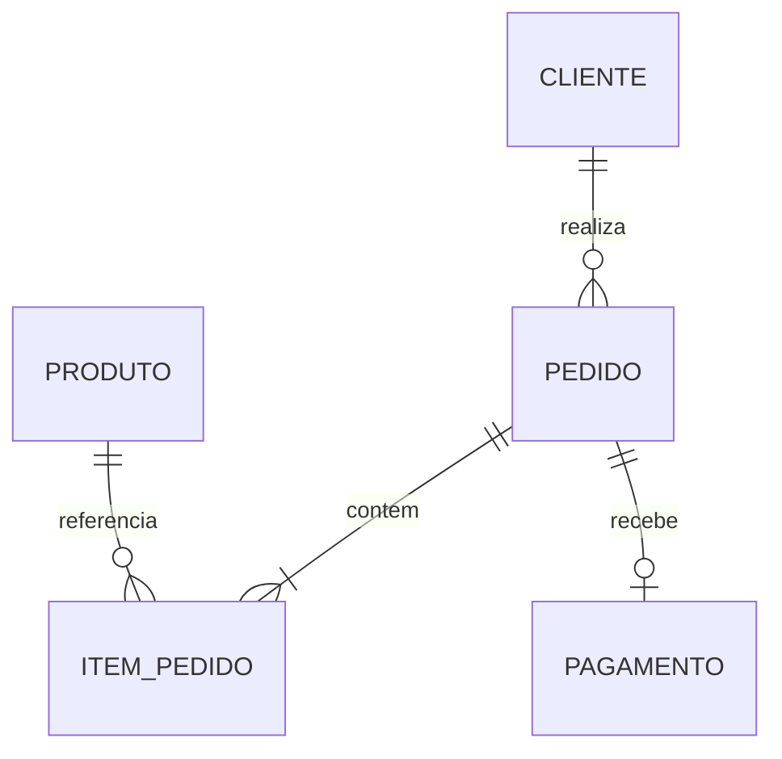

# Order Management API

REST API de gerenciamento de clientes, produtos e pedidos construída com ASP.NET Core, Entity Framework Core e SQL Server.

O fluxo de pedidos foi consolidado na **Semana 7**. Na **Semana 8**, o projeto recebe testes automatizados e melhorias de execução e documentação para apresentação como portfólio de backend.

## O que a API faz

- CRUD assíncrono de clientes e produtos;
- criação de pedido com vários itens;
- snapshot do preço do produto no momento da compra;
- pagamento por Pix (0%) ou cartão (3%);
- fluxo de status controlado;
- consulta de pedidos com cliente, itens, produtos e pagamento;
- filtros opcionais por cliente e status;
- validações de entrada e regras de negócio;
- persistência em SQL Server com EF Core e migrations.

## Domínio



Estados possíveis do pedido:

```text
Criado -> AguardandoPagamento -> Pago -> Enviado -> Entregue
                 |                 |
                 +----> Cancelado <-+
```

`Entregue` e `Cancelado` são estados finais.

## Tecnologias

- .NET 10 / ASP.NET Core
- Entity Framework Core 10
- SQL Server LocalDB
- Controllers, DTOs, Services e Repositories
- OpenAPI
- xUnit e NSubstitute para testes unitários

## Endpoints principais

| Método | Rota | Finalidade |
|---|---|---|
| `GET` | `/api/status` | Verificar a API |
| `GET/POST` | `/api/clientes` | Listar e cadastrar clientes |
| `GET/PUT/DELETE` | `/api/clientes/{id}` | Consultar, atualizar e excluir cliente |
| `GET/POST` | `/api/produtos` | Listar e cadastrar produtos |
| `GET/PUT/DELETE` | `/api/produtos/{id}` | Consultar, atualizar e excluir produto |
| `GET` | `/api/pedidos` | Listar pedidos e aplicar filtros |
| `GET` | `/api/pedidos/{id}` | Consultar o pedido completo |
| `POST` | `/api/pedidos` | Criar pedido |
| `POST` | `/api/pedidos/{id}/pagamento` | Pagar pedido |
| `PATCH` | `/api/pedidos/{id}/status` | Enviar, entregar ou cancelar pedido |

## Preparação local obrigatória

O projeto já inclui as migrations necessárias para o fluxo de pedidos. Para preparar o ambiente local, restaure as dependências, compile e aplique as migrations existentes ao banco usando os comandos abaixo.

```bash
dotnet tool restore
dotnet restore
dotnet build
dotnet ef database update
dotnet run --launch-profile http
```

O projeto possui um manifesto local que restaura a versão `10.0.10` do `dotnet-ef`, igual à versão dos pacotes do EF Core.

Quando as migrations forem alteradas, gere novamente o script SQL versionado:

```bash
dotnet ef migrations script --idempotent --output DatabaseScripts/OrderManagementApiDb.sql
```

Use [OrderManagementApi.http](OrderManagementApi.http) para executar o fluxo completo.

## Testes automatizados

Com o SDK .NET 10 instalado, execute na raiz do repositório:

```bash
dotnet test tests/OrderManagementApi.Tests/OrderManagementApi.Tests.csproj
```

O comando restaura as dependências necessárias, compila a API e executa os testes. Para estes testes unitários, não é necessário iniciar a API, configurar o LocalDB ou aplicar migrations.

Os testes usam o `PedidoService` real e substitutos dos repositórios criados com NSubstitute. A preparação comum está em métodos auxiliares; cada cenário cria seus próprios objetos e substitutos.

| Regra verificada | Casos |
|---|---:|
| Cartão: base de R$360, taxa de R$10,80 e total de R$370,80 | 1 |
| Pix: base de R$360, taxa zero e total de R$360 | 1 |
| Segundo pagamento recusado, preservando o primeiro | 1 |
| Transições proibidas: Pago → Entregue, Cancelado → Enviado, Entregue → Cancelado | 3 |
| Transições permitidas: Pago → Enviado, Enviado → Entregue, Pago → Cancelado | 3 |
| Pagamento usa o preço histórico do item após alteração do preço do produto | 1 |
| **Total** | **10** |

Execução local confirmada em 29/10/2026: **10 aprovados, 0 falhas e 0 ignorados**, após a extração da preparação comum.

Esses testes não exercitam HTTP, controllers, consultas do EF Core ou persistência no SQL Server. O cenário de preço histórico verifica o cálculo do pagamento usando o preço já armazenado no item; a cópia automática desse preço na criação do pedido ainda precisa de cobertura de integração. O roteiro manual continua disponível em [OrderManagementApi.http](OrderManagementApi.http).

A referência explícita a `System.Security.Cryptography.Pkcs 9.0.21` na API atualiza a dependência indireta trazida pelo cliente SQL e corrige os avisos [GHSA-2fmv-rv2c-59x7](https://github.com/advisories/GHSA-2fmv-rv2c-59x7) e [GHSA-846f-f764-76mx](https://github.com/advisories/GHSA-846f-f764-76mx) observados durante a restauração.

## Documentação de estudo

- [Arquitetura e regras](docs/ARQUITETURA.md)
- [Mapa de mudanças da Semana 6 para a 7](docs/MAPA_DE_MUDANCAS.md)
- [Configuração e teste local](docs/SETUP_LOCAL.md)
- [Guia acelerado da Semana 7](docs/GUIA_ESTUDO_SEMANA_7.md)
- [Relatório de validação da entrega](docs/RELATORIO_DE_VALIDACAO.md)

## Escopo consciente

Esta etapa inclui o fluxo de pedidos e os dez cenários unitários descritos acima. Testes de integração e infraestrutura de execução fazem parte das próximas etapas da Semana 8. Estoque, autenticação, cobrança real, deploy e observabilidade permanecem fora do escopo implementado.