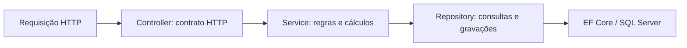

# Order Management API

[](https://github.com/gustavojesusdev/order-management-api/actions/workflows/ci.yml)

API REST de gerenciamento de clientes, produtos e pedidos, desenvolvida em **C# com ASP.NET Core 10, Entity Framework Core e SQL Server**. Projeto de estudo e portfólio de backend, com testes automatizados, ambiente Docker e integração contínua no GitHub Actions.

O foco é preservar a consistência de uma compra: guardar o preço original, calcular o pagamento simulado e permitir apenas mudanças de status válidas.

**Exemplo:** um pedido criado com duas unidades de R$100 continua com subtotal de R$200 mesmo que o produto passe a custar R$199,90. No cartão, a regra didática de 3% gera taxa de R$6 e total de R$206.

## Executar e demonstrar

No Windows, com Docker Desktop instalado, motor Linux/WSL 2 iniciado e porta 5211 livre:

```powershell
git clone https://github.com/gustavojesusdev/order-management-api.git
cd order-management-api
.\scripts\Start-Docker.ps1
.\scripts\Invoke-Demo.ps1
```

Se já clonou o projeto, execute os dois scripts na raiz do repositório.

O primeiro prepara a API e o SQL Server, aplica as migrations e o seed e aguarda as consultas responderem. Uma senha aleatória é criada em .env, ignorado pelo Git. O banco do Docker usa um volume separado do LocalDB.

O segundo demonstra o fluxo completo e interrompe caso uma resposta seja inesperada: cadastro, pedido, preço histórico, pagamento, recusas de operações inválidas, envio e entrega. Cada execução cria seus próprios registros no banco de demonstração e os mantém para consulta.

- Status: http://localhost:5211/api/status
- Produtos: http://localhost:5211/api/produtos
- [Roteiro da demonstração e resultados esperados](docs/DEMONSTRACAO.md)
- [Requisitos, portas, configuração e persistência do Docker](docs/DOCKER.md)
- [Execução nativa com SDK .NET 10 e SQL Server LocalDB](docs/SETUP_LOCAL.md)

## Funcionalidades e regras

- Cadastro, consulta, atualização e exclusão de clientes e produtos.
- Pedidos com vários itens, produtos existentes e ativos e cliente ativo.
- Rejeição de produtos repetidos e quantidades inválidas.
- Cópia do preço de compra para cada item, preservando o valor histórico.
- Pagamento **simulado** por Pix sem taxa ou cartão com taxa didática de 3%.
- Recusa de segundo pagamento e de transições de status incompatíveis.
- Filtros de pedidos por cliente e status.
- Exclusão restrita de clientes e produtos referenciados, preservando o histórico.
- Persistência em SQL Server com migrations, chaves, índices únicos e restrições.

O fluxo público de compra é:

```text
AguardandoPagamento -> Pago -> Enviado -> Entregue
```

Pedidos podem ser cancelados antes do envio. Entregue e Cancelado são estados finais. O cancelamento de um pedido pago preserva o registro do pagamento; não há estorno financeiro.

## Organização do código



Os DTOs definem os dados de entrada e saída; as entidades representam o domínio persistido. Interfaces permitem fornecer implementações reais na aplicação e repositórios simulados nos testes unitários.

O arquivo [OrderManagementApi.slnx](OrderManagementApi.slnx) reúne a API e os dois projetos de testes. No VS Code com C# Dev Kit, selecione-o em **.NET: Switch Solution**. Para compilar os três:

```powershell
dotnet build OrderManagementApi.slnx
```

Veja [arquitetura, relacionamentos e decisões](docs/ARQUITETURA.md).

## Testes e evidências

| Verificação | O que exercita |
|---|---|
| 10 testes unitários | PedidoService real, cálculos, transições e repositórios simulados com NSubstitute |
| 10 testes de integração | Rotas, controllers, serviços, EF Core e SQL Server LocalDB com bancos temporários isolados; o caso de status dispensa banco |
| Demonstração HTTP | Aplicação em execução, preço histórico e fluxo de compra até a entrega |
| Docker | Construção da imagem, inicialização de API/SQL e persistência após parar e iniciar |
| GitHub Actions | Testes em Release, publicação da API e relatórios TRX |

Para os unitários, use o SDK .NET 10. Para as integrações, use **Windows com SQL Server LocalDB e instância MSSQLLocalDB**:

```powershell
dotnet test tests/OrderManagementApi.Tests/OrderManagementApi.Tests.csproj
dotnet test tests/OrderManagementApi.IntegrationTests/OrderManagementApi.IntegrationTests.csproj
```

Os testes de integração iniciam a API com TestServer e criam seus próprios dados. Eles usam LocalDB no Windows, independentemente do banco Docker.

Em 30/10/2026, as duas suítes passaram localmente, a execução Docker e sua persistência foram confirmadas e o [CI passou na main após o merge](https://github.com/gustavojesusdev/order-management-api/actions/runs/41130330057).

- [Cenários de teste e preparação](docs/TESTES.md)
- [Funcionamento do CI](docs/CI.md)
- [Relatório de validação com datas e alcance](docs/RELATORIO_DE_VALIDACAO.md)

O CI é acionado por push para main/feat/week-8-portfolio e por pull requests para main. Não realiza deploy ou publicação de imagens Docker.

## Endpoints

| Método | Rota | Finalidade |
|---|---|---|
| GET | /api/status | Identificação e status da API |
| GET / POST | /api/clientes | Listar e cadastrar clientes |
| GET / PUT / DELETE | /api/clientes/{id} | Consultar, atualizar e excluir cliente |
| GET / POST | /api/produtos | Listar e cadastrar produtos |
| GET / PUT / DELETE | /api/produtos/{id} | Consultar, atualizar e excluir produto |
| GET / POST | /api/pedidos | Listar com filtros ou criar pedido |
| GET | /api/pedidos/{id} | Consultar pedido completo |
| POST | /api/pedidos/{id}/pagamento | Registrar pagamento simulado |
| PATCH | /api/pedidos/{id}/status | Enviar, entregar ou cancelar |

Use [OrderManagementApi.http](OrderManagementApi.http) para enviar as requisições manualmente. Os exemplos cobrem respostas de sucesso e erros esperados, incluindo HTTP 400, 404 e 409. O projeto também usa OpenAPI em ambiente Development.

## Alcance e evoluções

Esta entrega é uma demonstração funcional de backend. Os pagamentos não movimentam dinheiro. Não há interface de loja, autenticação/autorização, estoque, gateway financeiro, deploy público ou observabilidade implementados.

Os testes enumerados não comprovam cobertura total, carga ou concorrência entre requisições simultâneas. O banco garante unicidade, mas algumas disputas simultâneas ainda podem resultar em DbUpdateException; tratamento global de erros e controle de concorrência são evoluções futuras.

Próximas evoluções possíveis: autenticação, tratamento consistente de conflitos concorrentes e execução da integração com SQL Server em outros ambientes.

## Materiais de apoio

- [Como apresentar o projeto e explicar as decisões](docs/APRESENTACAO.md)
- [Roteiro de demonstração](docs/DEMONSTRACAO.md)
- [Histórico de estudo: guia da Semana 7](docs/GUIA_ESTUDO_SEMANA_7.md)
- [Histórico de evolução das Semanas 6 e 7](docs/MAPA_DE_MUDANCAS.md)
